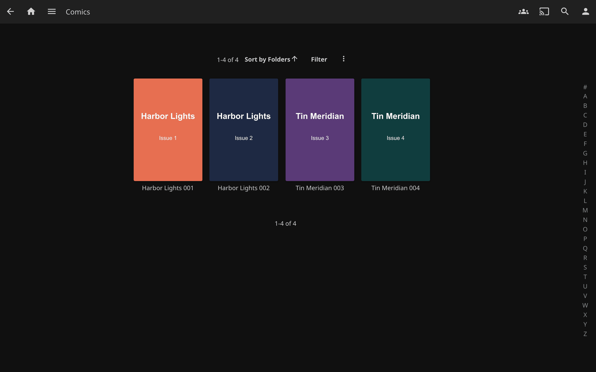
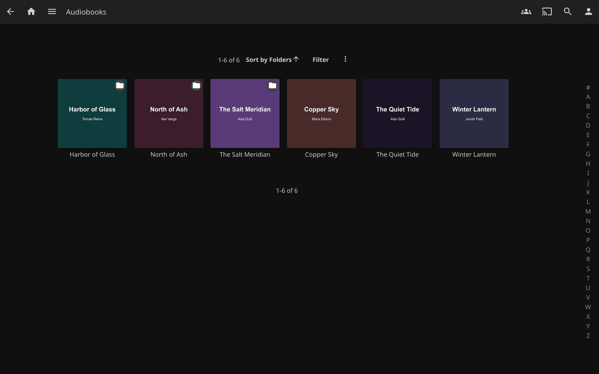

# How it works

## Supported formats

| Format | Type | Extraction Method |
|--------|------|-------------------|
| PDF | Book / Magazine / Comic | First-page rendering via built-in PDFium (no external tools needed) |
| EPUB | Book | Archive introspection with 3-tier image search |
| MOBI / AZW / AZW3 | Book | Cover record named by the EXTH header (tag 201), else the first image records |
| CBZ / CBR | Comic / Manga | Image named as the cover, else the first page in natural page order (built-in ZIP/RAR reading, no external tools) |
| MP3 | Audiobook / Music | Embedded art via `ffmpeg` raw stream copy |
| M4A / M4B | Audiobook / Music | Embedded art via `ffmpeg` raw stream copy |
| FLAC | Audiobook / Music | Embedded art via `ffmpeg` raw stream copy |
| OGG / Opus | Audiobook / Music | Embedded art via `ffmpeg` raw stream copy |
| WMA | Audiobook / Music | Embedded art via `ffmpeg` raw stream copy |
| AAC | Audiobook / Music | Embedded art via `ffmpeg` raw stream copy |
| WAV | Audiobook / Music | Embedded art via `ffmpeg` raw stream copy |
| Folder | Audiobook | Sidecar image lookup, the folder's own Jellyfin poster, then first-file embedded art |
| Any | Books and audiobooks | Online fallback via Open Library and Google Books |
| Any | Books, audiobooks, loose music files | A drawn title and author cover, when that setting is on |

## PDF: first page rendering

The plugin renders the first page of a PDF as a JPEG using a bundled PDFium native library (via the [PDFtoImage](https://www.nuget.org/packages/PDFtoImage) NuGet package). No external tools like `poppler-utils` or `pdftoppm` are required. DPI is configurable, and a per-render timeout prevents hangs on malformed files. The native library is included for Linux (x64, arm64, musl), macOS, and Windows.

## EPUB: 3-tier archive search

EPUBs are ZIP archives. When other plugins fail to extract a cover, SmartCovers opens the archive and searches with three strategies, in order:

1. **By filename**: files explicitly named `cover`, `portada`, `front`, `frontcover`, or `book_cover` (with any image extension).
2. **By path**: any image file with `cover` in its full archive path (e.g., `OEBPS/Images/cover-image.jpg`).
3. **By size**: the largest image in the archive (above 5 KB, to skip icons and logos).

When the EPUB holds no image at all, its package document (the OPF) still gives the online lookup the book's own
title, first author and any ISBN. File names are often cut short or carry a download site's noise.

## MOBI

A MOBI or AZW file is a PalmDB container: a record table, then the records, with the MOBI header in the first record
saying where the image records begin. SmartCovers takes the cover record named by the EXTH header (tag 201), then
its thumbnail, else the first image records; no external tools are needed.

## CBZ / CBR: comic archive first page

Comic archives are containers of page images: CBZ is a ZIP, CBR is a RAR. SmartCovers opens them with format detection based on the file **content, not the extension**. Mislabeled archives (a RAR renamed to `.cbz`, a ZIP renamed to `.cbr`) are common in the wild and still work. Both RAR4 and RAR5 are supported, including solid archives.



Cover selection follows comic conventions:

1. **Explicit cover entry**: an image named `cover`, `portada`, `front`, `frontcover`, or `book_cover` anywhere in the archive wins.
2. **First page in natural order**: otherwise the first image page is the cover, using *natural sort* so `page-2.jpg` correctly precedes `page-10.jpg` (plain alphabetical order would not).

macOS junk entries (`__MACOSX/`, AppleDouble `._*` files), hidden files, and tiny images (icons/thumbnails) are skipped, and every candidate is verified by magic bytes before being used, so an entry with an image extension but garbage content is passed over. Everything runs in-process; no external tools are required.

## Audio: raw stream copy with magic-byte detection

Jellyfin's built-in Image Extractor uses ffmpeg to *decode* embedded artwork. This fails when the codec tag does not match the actual data, a common problem in MP3 files where JPEG cover art is tagged as PNG in ID3 metadata.

SmartCovers sidesteps this entirely by using `ffmpeg -vcodec copy` to **raw-copy** the embedded image stream without decoding. It then identifies the actual format by inspecting magic bytes:

| Magic Bytes | Detected Format |
|-------------|-----------------|
| `FF D8 FF` | JPEG |
| `89 50 4E 47` | PNG |
| `47 49 46` | GIF |
| `42 4D` | BMP |
| `52 49 46 46 ... 57 45 42 50` | WebP |

Any leading null/padding bytes injected by the raw stream copy are stripped automatically.

## Folder-Based Audiobooks

For multi-file audiobooks stored as a directory of chapter files, the plugin:

1. Works out which folder names the book. A track is called `01` or `Pista 1`, which identifies nothing, so the folder name is used instead, and for a multi-disc rip (`CD1`, `Disco 3`, `<title> CD 4`, or a bare number) the folder above the disc. It never climbs to the library root, and never treats a shelf of several books as one book.
2. Checks for an image file in that folder: an exact `cover.jpg` / `folder.jpg` / `front.jpg` / `poster.jpg` / `thumb.jpg`, then any image whose name contains a cover word (`CoverArt.jpg`), then an image named after the book (`Cabo Trafalgar.jpg` in `[Audiolibro mp3] Cabo Trafalgar- Arturo Pérez-Reverte 2004`), then, if the folder holds exactly one image, that image.
3. Falls back to embedded art from the first audio file, looking inside the first disc subfolder when the folder itself holds no audio.
4. Takes the poster Jellyfin already holds for the book folder itself. Jellyfin does not hand a folder's poster down to its tracks, so without this every track shows a blank tile even when the book has a cover.
5. Remembers the result per book folder, hit or miss, so a hundred-track rip costs one lookup rather than a hundred. A miss caused by a catalogue that could not be reached is not remembered, so the next track asks again.



## Online Cover Fetching (Last Resort)

When all local extraction methods fail, the plugin can search online sources for a matching cover:

1. **By ISBN**, when the file name or the EPUB's metadata carries one with a valid checksum (an EPUB identifier that names another scheme, such as a calibre id, is never taken for one): Open Library's search by ISBN, which gives the edition's cover or its work's, then Google Books. An OCLC number in the name is searched the same way. Covers are fetched by cover id, which Open Library does not rate-limit per address the way it limits lookups by ISBN.
2. **Open Library** (openlibrary.org) by its title and author fields.
3. **Open Library free-text search**. The title field matches the work's title, usually the original English one, so `Hacia la Fundación` by Isaac Asimov finds nothing there while a free-text search finds *Forward the Foundation*. A free-text hit is only taken when it names our author, also on the title-only retry below; only a book with no known author is searched this way unchecked, and only for a title of four words or more.
4. **Google Books** (books.google.com), held to the same rule as the free-text search: a result must name our author, and with no known author only a title of four words or more is searched. The largest scan is asked for first; when Google answers that with its grey "image not available" picture or a strip cut from a title page, the thumbnail the API listed is used instead.
5. If that finds nothing, the title alone is retried; then title and author swapped, since plenty of folders are named `<Author> - <Title>` and nothing in the name says which half is which; then the main title with its subtitle dropped (after a colon, a full stop, or a comma followed by three or more words), which is how catalogues index a title.

Every downloaded image is checked before it is used. One wider than 1.5 times its height cannot be a book cover (square audiobook covers and oblong picture books pass), and Google's "image not available" picture is recognised by its content at any size. A rejected image counts as no cover: the next source is tried, and an item that already carries a drawn cover keeps it.

A title that identifies nothing is never searched for. A numbered disc folder yields the title `2`, which matches hundreds of thousands of books, and the first one's cover would otherwise be shipped as yours. The subtitle retry is likewise limited to multi-word main titles.

The title and author come from the best source available: an EPUB's own metadata, the Album and Artist tags of an audiobook track (`ASIMOV, Isaac` reads as `Isaac Asimov`), the authors Jellyfin holds for a book, then the name. Names are cleaned of format tags like `(Mp3)`, locale tags like `[Castellano]`, Audible codes, year suffixes, series indicators and OCR tags like `(texto OCR, HathiTrust)`. Anna's Archive names (`Title -- Author -- Place, Year -- Publisher -- isbn13 ... -- <md5> -- Anna’s Archive`) are read field by field. A list of authors is searched by its first name. Fetched covers are cached by Jellyfin after the first scan, so online lookups only happen once per item.

Without an API key, Google Books often refuses every request because the shared daily quota is used up. The plugin then logs one warning, skips Google Books for six hours, and relies on Open Library. Set a key in the settings to use it. A key Google rejects (wrong, or its project lacks the Books API) gets its own warning and the same pause.

When Open Library refuses a request (429, 403 or a 5xx), the rest of that lookup stops asking it and every lookup skips it for five minutes, with one warning. The items missed meanwhile are reported as a network error, never drawn, and retried on the next run.

This feature is **enabled by default** and can be toggled in the plugin settings.


## Drawn covers

Some books have no cover anywhere: a text-only EPUB rebuilt from OCR, a self-published audiobook, a personal
recording. With **Draw a plain cover** on (it is off by default), SmartCovers draws one: the title in large type and
the author below it, on a background colour picked from the title, so the same book always gets the same colour.

It only draws after every real source has said no. It never draws after a network error, because the next run may
find the real cover. It never draws for movies or TV, nor for music tracks in an album folder, which show the
album's art. A track that belongs to no album can get one: a file loose in a music library's top folder, or a
track in a folder Jellyfin did not make an album because it collects songs from many albums. It never replaces a
real cover. Jellyfin asks its image fetchers in the library's order and keeps the first image, so put SmartCovers
last when this setting is on; otherwise a drawn cover can come before another fetcher's real one, until the nightly
task swaps it. The fonts come from the server; none
is bundled. The official Jellyfin image has them; on a host without fonts nothing is drawn and the log says so.

A drawn cover carries a marker, so it is never taken for a real cover found beside the media, and the nightly task
keeps checking those items for a real one and swaps it in when it turns up.

## Refreshing Covers That Were Missed

Jellyfin asks image providers for a cover once, when an item is new, and does not
come back to a miss. So anything already in your library when you installed the
plugin keeps its blank tile, however well the plugin works from then on, and so
does anything that was scanned while an online catalogue happened to be
rate-limited.

The plugin ships a scheduled task, **Refresh items missing a cover**, to close
that gap. It finds books, audiobooks and audiobook folders with no primary image
in the libraries where SmartCovers is enabled as an image fetcher, and refreshes
their images; metadata is left alone and any image you already have is kept.
Items with a drawn cover are refreshed too, so a real cover replaces it. Plain
folders count only in book libraries, so movie folders are left alone. It
runs daily at 04:00 by default, and you can run it on demand from **Dashboard ->
Scheduled Tasks**, where its schedule can also be changed or the task disabled.

Its log says what happened to each book, once per book rather than once per track:

```
Found 30 items with no real cover: 2 books, 25 tracks in 1 audiobooks, 1 single-file audiobooks, 2 audiobook folders, 0 music tracks; 0 of them carry a drawn cover and are checked for a real one
No cover for "El ultimo hereje" by "Jesús Ávila Granados" (audiobook, 25 tracks): no online match (Google Books skipped: quota exhausted) [/audiolibros/El ultimo hereje (mp3) Jesús Ávila Granados 2013]
No cover for "Archivística en Navarra" by "Navarre (spain), Departamento De Educación Y Cultura" (book): network error (Open Library: 429 TooManyRequests) [/libros/Archivística en Navarra - ....epub]
Done: 3 got a real cover (1 books, 0 audiobook tracks, 2 audiobook folders, 0 single-file audiobooks, 0 music tracks), 0 got a drawn cover, 0 drawn covers replaced with a real one, 0 keep their drawn cover, 27 still have none
Still without a cover, by reason: no online match 26, network error 1
```

The reasons are: no image in file, no online match, unsearchable title, network
error (with the catalogue's answer, such as `Open Library: 429 TooManyRequests`),
online lookup off, not one book, not a book library, no font to draw a cover,
and provider not run (another image fetcher answered first, or Jellyfin skipped
the item).
